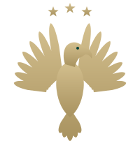

<div dir="rtl">

# SyrAI — سيراي



مساعد ذكاء اصطناعي **عربي بالكامل**: الواجهة عربية من اليمين إلى اليسار، والإجابات بالعربية دائمًا، والبحث مقيّد **بالمصادر العربية فقط**.

## المزايا

- **مصادر عربية فقط:** يبحث المساعد في قائمة مواقع عربية موثوقة (ويكيبيديا العربية، سانا، عنب بلدي، الجزيرة نت، بي بي سي عربي، المكتبة الشاملة…). القيد مفروض على مستوى أداة البحث نفسها (`allowed_domains`)، فلا يمكن للنموذج الوصول إلى أي موقع خارج القائمة. يمكن تعديل القائمة من `server/sources.js`.
- **ذكر المراجع:** تظهر روابط المصادر تحت كل إجابة، والمصادر المقتبس منها مباشرة مميّزة باللون الذهبي.
- **مريح للعين:** ألوان هادئة مستوحاة من الهوية البصرية السورية (الذهبي، الأخضر الغامق، الرملي)، وضع فاتح وداكن، تكبير وتصغير الخط، وخط IBM Plex Sans Arabic بمسافات أسطر واسعة.
- **سهل الاستخدام:** اقتراحات أسئلة جاهزة، سجل محادثات محفوظ في المتصفح، زر إيقاف، نسخ الإجابة، ويعمل على الهاتف.

## التشغيل

```bash
npm install
cp .env.example .env      # ثم ضع مفتاح ANTHROPIC_API_KEY
npm run dev               # الواجهة: http://localhost:5173
```

للإنتاج:

```bash
npm run build
npm start                 # http://localhost:3001
```

## البنية

| الملف | الوظيفة |
|---|---|
| `server/index.js` | خادم Express يتصل بـ Claude ويبث الرد مباشرة (SSE) |
| `server/sources.js` | قائمة المصادر العربية المسموح بها |
| `src/App.jsx` | واجهة المحادثة |
| `src/components/Markdown.jsx` | عرض تنسيق الإجابات بأمان |
| `public/syria-eagle.svg` | الشعار |

## الشعار

الشعار رسم مبسّط للعقاب الذهبي من الهوية البصرية السورية الجديدة (العقاب بجناحين مفرودين، فوقه ثلاث نجوم، وذيل من خمس ريشات). لاستخدام الملف الرسمي، ضعه مكان `public/syria-eagle.svg` بالاسم نفسه، وسيظهر تلقائيًا في كل مكان في التطبيق وفي أيقونة المتصفح.

</div>
